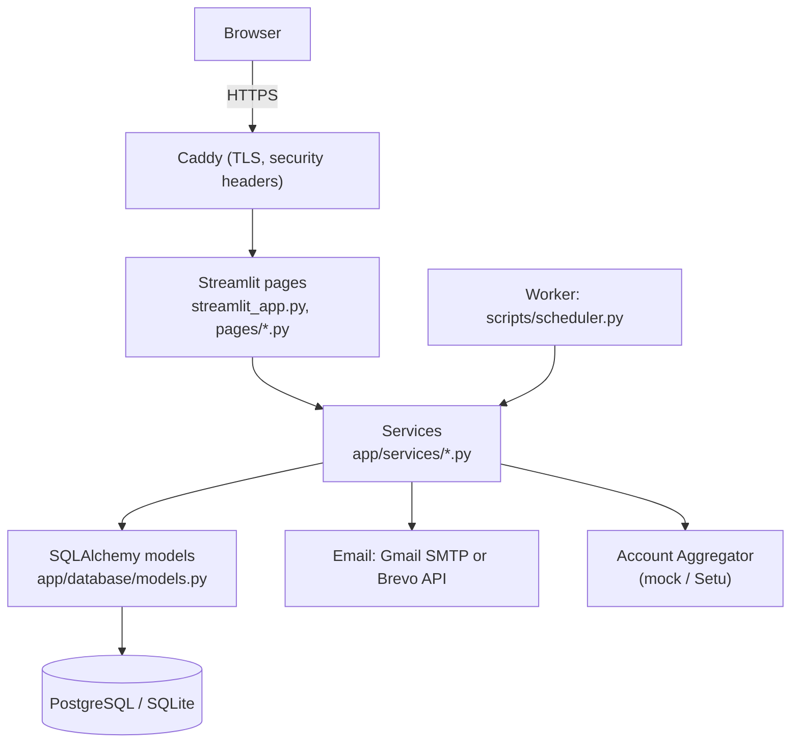

# Architecture

FinanceOS is a Python web app built with Streamlit, SQLAlchemy and Alembic, backed by
SQLite (single machine) or PostgreSQL (production).

## Layers

| Layer | Folder | Rule |
| --- | --- | --- |
| Pages | `streamlit_app.py`, `pages/`, `app/ui/` | Display and input only. No SQL. Call services. |
| Services | `app/services/` | All business logic. Every function that touches user data takes `user_id` and filters by it. |
| Data | `app/database/` | Tables, engine, sessions, migrations runner. |
| Migrations | `migrations/` | Alembic revisions, one per schema change. |
| Jobs | `scripts/` | Daily reminders, summaries, backups, configuration. |

## Request flow

1. Streamlit runs `streamlit_app.py` for every interaction (each browser session is isolated).
2. The app validates settings, applies the theme, and checks the session: logged in,
   active account, not idle for longer than `SESSION_TIMEOUT_MINUTES`.
3. The selected page runs, reads `user_id` from the session via `current_user_id()` and
   calls services with it.
4. Services open a database transaction with `get_session()` (commit on success, rollback
   on any error). Multi-step operations pass one session through every step with
   `use_session(session)` so they commit together.

## Data isolation

- Every financial row has a `user_id`.
- Every service query filters by `user_id`; writes check that referenced rows (accounts,
  bills, goals...) belong to the same user.
- Family sharing is the only cross-user read: `family_service.can_view()` is checked on
  every view, and the owner can revoke at any time.
- Admin functions return counts, never amounts.
- Tests (`test_users_cannot_touch_each_others_data`, `test_many_users_data_kept_apart`,
  family tests) guard these rules.

## Services map

| Service | Responsibility |
| --- | --- |
| `auth_service` | Email validation, OTP sign-up, login, lockout, password reset/change |
| `email_service` | SMTP (with port fallback) and Brevo HTTPS sending |
| `audit_service` | Security event log |
| `account_service` | Accounts; balances computed from transactions |
| `transaction_service` | Add, list, edit, delete, bulk import, dedupe, transfer detection |
| `categorization_service` | Narration parsing, keyword rules, learned rules |
| `import_service` | CSV/Excel/PDF statement parsing |
| `aa_service` | Account Aggregator provider interface (mock, Setu skeleton) |
| `analytics_service` | Period summaries, monthly series, breakdowns, budget usage |
| `forecast_service`, `health_service`, `insights_service`, `anomaly_service`, `recurring_service`, `recommendation_service` | Analysis |
| `budget_service`, `goal_service`, `bill_service`, `wealth_service`, `investment_service`, `credit_score_service` | Planning features |
| `family_service` | Read-only sharing |
| `notification_service` | In-app alerts, reminder and summary emails |
| `report_service`, `chart_service` | In-memory PDF reports |
| `account_admin_service`, `admin_service`, `backup_service` | Export, deletion, admin, backups |

## Key decisions

- **Balances are computed** (`opening_balance + credits - debits`), never stored, so they
  can't drift from transactions.
- **Money is `Numeric(14, 2)`**, never float.
- **Imports are idempotent**: each imported row has a hash; re-imports skip duplicates.
- **Reports and exports are generated in memory**, never written to shared disk paths.
- **Streamlit** keeps the code base small for a single developer. If you later need a
  mobile app, put a FastAPI layer over the same services; the services don't depend on
  Streamlit.
