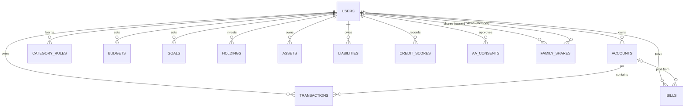

# Data model

Defined in `app/database/models.py`; schema changes go through Alembic (`migrations/versions`).

| Table | Purpose | Notes |
| --- | --- | --- |
| `users` | Accounts | bcrypt `password_hash`, `email_verified_at`, `consented_at`, `is_active`, `last_login_at`, email preferences |
| `email_otps` | Sign-up and reset codes | HMAC-hashed code, expiry, attempts; pending name/password hash until verified |
| `login_attempts` | Failed logins per email | Also for unknown emails, so lockouts don't reveal accounts |
| `audit_log` | Security events | Kept after user deletion (`user_id` not a foreign key) |
| `accounts` | Bank, card, wallet, cash | `opening_balance`; current balance is computed |
| `transactions` | Money in and out | `amount` always positive + `txn_type`; `dedupe_hash` unique per account; `is_transfer`; `category_locked` when the user set it |
| `category_rules` | Learned merchant → category | Unique per user and merchant |
| `budgets` | Monthly limit per category | Unique per user and category |
| `goals` | Savings goals | |
| `holdings` | Investments | `identifier` (ISIN + folio) unique per user for CAS re-imports |
| `assets`, `liabilities` | Property, loans etc. | |
| `bills` | Due dates and reminders | `last_reminded_for` prevents duplicate reminder emails |
| `credit_scores` | Score history | |
| `family_shares` | Read-only sharing | `pending` / `accepted`; unique per owner and email |
| `aa_consents` | Bank-link consents | |

## Deletion

Deleting a user (by themselves or an admin) removes every row they own, family shares in
both directions and pending codes, in one transaction. Audit entries remain.
